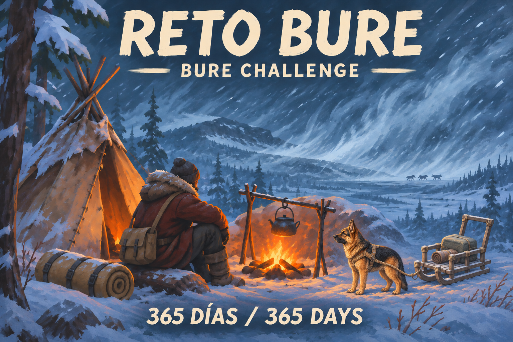

# Bure Challenge 365

Un reto de supervivencia nómada para **The Long Dark · Interloper**. La versión **0.2.78** incluye **cinco meses jugables, días 1–150**, con 153 objetivos contando los hitos.

## Español

| Mes | Qué harás |
| --- | --- |
| 1 · Primeros pasos | Consigue agua, fuego, abrigo y equipo básico. Elige una de tres recompensas por objetivo. |
| 2 · Compañero de viaje | Prepara el transporte, cambia de región y monta un refugio para seguir viajando. Con los complementos Bure, puedes usar el perro y el trineo. |
| 3 · Oficio de curtidor | Reúne pieles y tripas, cúralas y organiza el campamento alrededor del bastidor de curtido. |
| 4 · Artesano errante | Prepara materiales de forja, fabrica herramientas, aparejos, flechas y arco, y termina en el banco de trabajo del tipi o con el objetivo alternativo del juego base. |
| 5 · El lago del castor | Coloca y ceba trampas, cura las pieles y fabrica y equipa el gorro y las manoplas. Requiere **Burebista Beaver**. Una tirada fallida se puede reintentar tras otras seis horas de juego. |

Abre la libreta pulsando el lobo del menú de pausa. Cada mes completado desbloquea una cabeza de lobo en el HUD. Las que se encienden aportan **+2 °C cada una**. Solo se activan las necesarias.

En **Trueques del dron**, elige el pedido y llama al dron desde un claro. Pulsa **E** junto al dron cuando aterrice para entregar el pago. Vuelve con una caja en paracaídas. Sigue la baliza ámbar y pulsa **E** junto a la caja para recogerla. Los trofeos terminados pueden cambiarse por sal, harina o aceite según la oferta.

Instala **MelonLoader** y **ModData**. Con el juego cerrado, copia la DLL del release a `TheLongDark/Mods`. Si usas Burebista Starting Equipment, déjalo en **OFF**. Para empezar, selecciona **Reto Bure**. Si ya tienes una partida del reto, puedes continuarla.

La consola de desarrollador y los comandos de trucos están prohibidos. Al tercer intento, el guardado queda descalificado del reto y debes empezar una partida nueva.

## English

A nomadic survival challenge for **The Long Dark · Interloper**. Version **0.2.78** includes **five playable months, days 1–150**, with 153 objectives including milestones.

| Month | What you’ll do |
| --- | --- |
| 1 · First Steps | Earn water, fire, shelter and basic gear. Choose one of three rewards per completed objective. |
| 2 · Travel Companion | Prepare your transport, move to another region and set up a travel camp. The Bure addons support a dog and sled. |
| 3 · The Tanner’s Trade | Gather and cure hides and guts, then set up camp around your curing rack. |
| 4 · Wandering Craftsman | Gather forge supplies, make tools, tackle, arrows and a bow, and finish at the tipi workbench or through the base-game alternative. |
| 5 · Beaver Lake | Set and bait traps, cure the pelts and craft and wear the hat and mittens. Requires **Burebista Beaver**. An unsuccessful roll can be retried after another six in-game hours. |

Click the wolf head in the pause menu to open the notebook. Each completed month unlocks one HUD wolf head. Active heads add **+2 °C each**. Only as many as needed activate.

Under **Drone Trades**, pick an order and call the drone from open ground. Press **E** beside the landed drone to hand over payment. It returns with a parachute crate. Follow the amber beacon and press **E** beside the crate to collect it. Finished trophies can be traded for salt, flour or oil, depending on the offer.

Install **MelonLoader** and **ModData**. Close the game and put the release DLL in `TheLongDark/Mods`. If you use Burebista Starting Equipment, set it to **OFF**. Select **Bure Challenge** to start. Existing challenge saves can continue.

The developer console and cheat commands are prohibited. On the third attempt, the save is disqualified from the challenge and you must start a new run.

## Capturas / Screenshots

### Libreta y calor / Notebook and warmth

### Dron, paracaídas y baliza / Drone, parachute and beacon

## Próximas actualizaciones / Future updates

🇪🇸 Las actualizaciones seguirán durante el resto del año y continuarán hasta completar los 365 días del reto. Quedan los meses 6–12, del día 151 al 365.

🇬🇧 Updates will continue through the end of the year and until the full 365-day challenge is complete. Months 6–12, covering days 151–365, are still to come.

